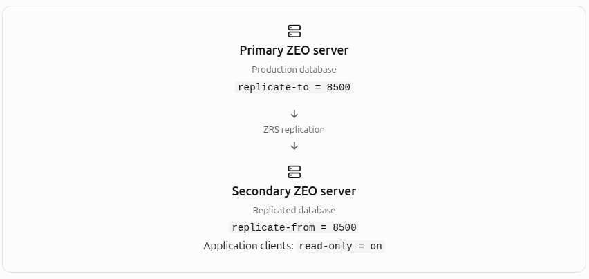

# ZODB Replication with ZRS - Historical Plone Setup and Validation Guide

> **Status:** Historical configuration reference, not a verified production runbook.
>
> **Source:** *How to setup Plone ZRS and replication* (three-page internal guide supplied to the Bika LIMS team), written for **Plone 4.3.11**. The examples below preserve its approach while identifying issues that must be checked before reuse.
>
> **Scope:** Buildout-managed Plone / Bika LIMS installations using ZEO and `zc.zrs`. These instructions are **not** a Docker Compose replication procedure, nor a validated recipe for Plone 5.2 or Plone 6.

## Contents

1. [Overview](#1-overview)
2. [Prerequisites and compatibility](#2-prerequisites-and-compatibility)
3. [Primary instance](#3-primary-instance)
4. [Secondary instance](#4-secondary-instance)
5. [Starting services and inspecting logs](#5-starting-services-and-inspecting-logs)
6. [BlobStorage, security and operational safeguards](#6-blobstorage-security-and-operational-safeguards)
7. [Validation and recovery planning](#7-validation-and-recovery-planning)
8. [References](#8-references)

## 1. Overview

ZRS (`zc.zrs`) replicates ZODB storage transactions from a **primary** server to a **secondary** server. In the source document, the primary's ZEO server is configured with `replicate-to`; the secondary's ZEO server uses `replicate-from`. The example secondary application clients are configured as read-only.

```text
Primary Plone / Bika LIMS             Secondary Plone / Bika LIMS
  ZEO (read/write)                        ZEO (replica)
  replicate-to = 8500   ---------->       replicate-from = <primary-host>:8500
                                          clients: read-only = on
```



This illustrates the historical configuration, **not** a tested network or failover topology. A replica can contain unwanted changes propagated from the primary. Maintain independent, versioned **ZODB and BlobStorage backups** in addition to replication. See [Production Backup and Restore Procedure](production-backup-and-restore.md).

## 2. Prerequisites and compatibility

The original procedure was written for **Plone 4.3.11** and shows these historical pins:

| Package | Historical version |
| --- | --- |
| `zc.zrs` | `2.4.4` |
| `Twisted` | `17.9.0` |
| `Automat` | `0.8.0` |
| `python-attrs` | `18.1.0` |

**Do not copy these pins into Plone 5.2 or Plone 6 without a compatibility review.** Confirm the installed Python, Plone, ZODB, ZEO, `plone.recipe.zeoserver` and `zc.zrs` versions together. The source links to a community discussion about Python 3 and Plone 5.2 but does not establish a tested configuration for those versions.

Before making changes:

- Use separate primary and secondary instances and a non-production environment for the first test.
- Identify the actual buildout sections, ZEO endpoints, storage paths and service manager.
- Ensure a **verified backup of the existing ZODB and BlobStorage** is available.
- Choose distinct ZEO and replication ports; restrict replication access to trusted hosts.
- Establish how the secondary BlobStorage will be populated and verified (see Section 6).

## 3. Primary instance

### 3.1 Create the instance (historical installer example)

The source shows:

```bash
./install.sh --target=/path/to/primary --build-python zeo
```

This installer invocation is **version-specific**. Do not assume it applies to an existing installation or modern Plone releases.

### 3.2 Configure the primary ZEO server

The original example adds ZRS to the existing `[zeoserver]` section:

```ini
[zeoserver]
<= zeoserver_base
recipe = plone.recipe.zeoserver[zrs]
eggs =
    plone.recipe.zeoserver[zrs]
    ${buildout:eggs}
zeo-address = 0.0.0.0:8400
replicate-to = 8500
```

`zeoserver_base` is an **existing inherited section in the source installation**, not a universal buildout section. The exact syntax, recipe extras and port bindings require validation against the deployed buildout. The `0.0.0.0` binding is from the historical example; prefer a restricted interface and firewall rules rather than exposing ZEO publicly.

The source notes that the **primary uses `replicate-to`**.

### 3.3 Apply buildout (historical example)

```bash
./bin/buildout -N
```

Only do this after reviewing dependency changes and the applicable production buildout procedure. Running buildout can modify installed packages and generated scripts.

## 4. Secondary instance

### 4.1 Create the instance (historical installer example)

```bash
./install.sh --target=/path/to/secondary --build-python zeo
```

The source's prose accidentally refers to the primary target in the secondary section; the command itself specifies `/path/to/secondary`.

### 4.2 Configure the secondary ZEO server

```ini
[zeoserver]
<= zeoserver_base
recipe = plone.recipe.zeoserver[zrs]
eggs =
    plone.recipe.zeoserver[zrs]
    ${buildout:eggs}
zeo-address = localhost:8700
replicate-from = <primary-host>:8500
```

The source's example uses `replicate-from = 8500` without a host. This guide shows the intended endpoint explicitly as a **placeholder**, not as a claim about accepted syntax for every `zc.zrs` version. Confirm the exact option format with the installed recipe and network configuration.

### 4.3 Configure read-only secondary clients

The source shows two clients:

```ini
[client1]
<= client_base
recipe = plone.recipe.zope2instance
zeo-address = ${zeoserver:zeo-address}
http-address = 8780
read-only = on

[client2]
<= client_base
recipe = plone.recipe.zope2instance
zeo-address = ${zeoserver:zeo-address}
http-address = 8781
read-only = on
```

`client_base` is another source-specific inherited section. Confirm that `read-only = on` has the intended effect in the installed Plone and recipe versions; do not route normal production writes to the secondary.

## 5. Starting services and inspecting logs

The historical procedure starts the ZEO server and clients with instance scripts:

```bash
./bin/zeoserver start
./bin/client1 start
```

And inspects the ZEO log:

```bash
tail -f var/zeoserver/zeoserver.log
```

On deployments managed by Supervisor or systemd, use the actual service manager instead. The source gives examples of the primary reporting `PrimaryFactory starting` and a secondary connection, while the secondary reports `opening storage '1' using ZRS`, `SecondaryFactory`, `1:RO` and a connection to the primary.

These log lines are **diagnostic clues, not proof of complete replication**. The original examples also contain a warning that the blob directory has an insecure mode setting; investigate and correct storage permissions rather than ignoring that warning.

## 6. BlobStorage, security and operational safeguards

**BlobStorage requires separate verification.** The source displays BlobStorage paths in startup logs but does **not** document a complete blob replication mechanism, an end-to-end blob consistency test, or a tested failover procedure. Do not infer from ZRS transaction replication alone that every attachment is available on the secondary.

For a production design, establish and test:

- How blob files are made available to the secondary, and whether that mechanism is supported by the selected versions and storage topology.
- Whether restored or replicated sample attachments and Certificates of Analysis open correctly.
- How consistency between ZODB references and blob files is checked after catch-up and recovery.
- Authentication, restricted replication ports, filesystem permissions and transport protection appropriate to the environment.
- Monitoring for disconnects, lag, errors, disk capacity and inode pressure where relevant.
- Independent local and off-server backup sets, with historical retention and test restores.

Do not expose the ZEO or replication service to the public Internet. Replication is not a historical backup and does not by itself provide a safe, automatic promotion procedure.

## 7. Validation and recovery planning

The following is a **proposed test checklist**, not a procedure demonstrated by the source PDF:

1. Record all installed component versions and the actual primary/secondary endpoint configuration.
2. Take and verify an independent backup of ZODB and BlobStorage before testing.
3. Start the primary and secondary in an isolated environment; confirm the secondary connects without repeated errors.
4. Create a representative test record on the primary, then confirm that it appears on the secondary after replication catches up.
5. Add a test attachment and confirm that its blob can be opened on the secondary.
6. Check the secondary cannot accept unintended writes.
7. Test a controlled primary interruption and recovery, documenting what happens to the secondary; **do not improvise promotion of a live replica**.
8. Document how to return to a single authoritative primary without divergent writes or data loss.
9. Test recovery from an independent versioned backup, not only from the replica.
10. Record the results, unresolved gaps, operator, tested versions and approval before any production rollout.

**Production readiness:** A modern Plone 5.2/6 replication design requires its own version-specific configuration, BlobStorage verification, monitoring, and a tested failover/rejoin runbook. The historical PDF alone does not establish those requirements.

## 8. References

- Historical source: *How to setup Plone ZRS and replication*, three-page Plone 4.3.11 guide supplied to the Bika LIMS team.
- [`zc.zrs` on PyPI](https://pypi.org/project/zc.zrs/)
- [Historical `zc.zrs` 2.4.4 release](https://pypi.org/project/zc.zrs/2.4.4/)
- [Plone community: ZRS in Python 3 and 5.2](https://community.plone.org/t/zrs-in-python-3-and-5-2/12387/5)
- [Quintagroup: ZRS](https://quintagroup.com/cms/zope/zrs)
- [Production Backup and Restore Procedure](production-backup-and-restore.md)
